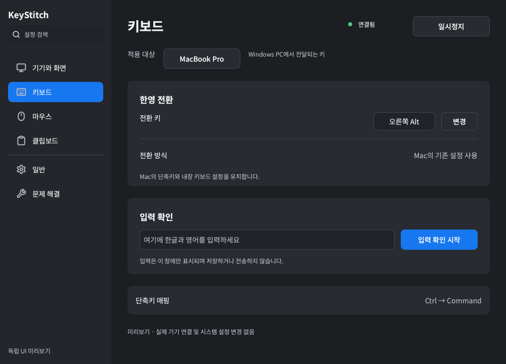

# KeyStitch 독립 QML 미리보기

메인 화면·키보드 설정·메뉴바 패널을 하나의 Figma 파일에서 관리하고,
키보드 설정부터 Qt Quick으로 구현한 개발용 미리보기다.

- [Figma 파일](https://www.figma.com/design/dKvWUPFPitrOBlto3ocAZt)
- [메인 화면](https://www.figma.com/design/dKvWUPFPitrOBlto3ocAZt?node-id=5-179)
- [키보드 설정](https://www.figma.com/design/dKvWUPFPitrOBlto3ocAZt?node-id=5-2)
- [메뉴바 패널](https://www.figma.com/design/dKvWUPFPitrOBlto3ocAZt?node-id=5-332)

`01 Screens`에 세 화면, `02 Components`에 공통 컴포넌트와 아이콘,
`03 Handoff`에 구현 범위와 연결 규칙을 둔다. 세 화면은 대안이 아니라
한 제품의 메인 창, 설정 페이지, 빠른 제어 패널이다. Vorssaint 참고 방향의
어두운 표면·간결한 사이드바·파란 강조색을 KeyStitch 구성에 적용했다.



## 실행

저장소 루트에서 Python 3.12와 별도 가상 환경을 사용한다.

```sh
python3 -m venv tools/ui-preview/.venv
tools/ui-preview/.venv/bin/python -m pip install -r tools/ui-preview/requirements.txt
tools/ui-preview/.venv/bin/python tools/ui-preview/preview.py
```

마지막 명령은 **별도 KeyStitch UI Preview 창**을 연다. 기존 Input Leap 앱을
종료하거나 교체하지 않는다. Windows에서는 가상 환경 실행 파일 경로를
`.venv/Scripts/python.exe`로 바꾼다. Windows 실행은 아직 검증하지 않았다.

사용 중인 앱에 연결하지 않고 상태를 `PreviewModel.qml`의 메모리에만 보관한다.
연결됨·기기 이름·일시정지·전환 키·Ctrl/Command 매핑은 예시 상태다.
재시작하면 초기화된다. 시스템 단축키, 입력 소스, 사용자 설정, 실행 중인
클라이언트/서버에는 접근하지 않는다. 입력 확인란은 일반 Qt 텍스트 필드이며
실제 원격 한영 전환 성공을 판정하는 검사기는 아니다.

키보드 화면의 검색, 일시정지/재개, 전환 키 선택/취소, 입력란 포커스,
매핑 펼치기와 로컬 토글을 조작할 수 있다. 다른 탐색 메뉴와 기기 선택은
이번 구현 범위를 설명하는 대화상자를 연다. 메인 화면과 메뉴바는 Figma 설계만
완료했으며 실제 창·트레이 연동은 구현하지 않았다.

## 스택과 디자인 관리

- **화면:** Qt 6.10.1 / Qt Quick Controls / QML.
- **개발용 실행기:** PySide6-Essentials. Python은 미리보기 호스트이고 제품의
  C++ 입력 엔진을 대체하지 않는다. 저장소의 기존 CMake 빌드에 포함하지 않았다.
- **제품 통합 시:** 같은 QML 앞에 C++ 상태 어댑터를 연결한다. 실제 상태 조회,
  적용·실패 응답, 저장 정책, 메뉴바 수명/포커스는 별도 개발·검증 대상이다.
- **공통 디자인:** Figma 변수·텍스트 스타일·컴포넌트 인스턴스.
  [figma-manifest.json](design/figma-manifest.json)에 노드와 QML 대응을 기록했다.
- **코드 테마:** [tokens.json](design/tokens.json) → `generate_theme.py` →
  `qml/Theme.qml`. 생성 파일 대신 토큰 스냅샷을 수정한다.

Figma의 원본 컴포넌트 변경은 파일 내 인스턴스에 반영된다. QML로의 실시간
자동 동기화나 Code Connect 연결은 구성하지 않았다. 변경할 때는 다음 순서를 따른다.

1. Figma의 공통 변수·컴포넌트와 세 화면을 함께 검토한다.
2. 승인된 색·간격·글꼴 값을 `design/tokens.json`에 반영하고 출처 날짜를 갱신한다.
3. `python3 tools/ui-preview/generate_theme.py`로 테마를 생성한다.
4. 구조 변경은 대응 QML에 반영하고 렌더링을 Figma와 비교한다.
5. 검사 후 `design/keyboard-preview.png`를 새 렌더링으로 갱신한다.

## 검증

저장소 루트에서 다음 명령으로 데스크톱 창 없이 검증할 수 있다.

```sh
tools/ui-preview/.venv/bin/python tools/ui-preview/generate_theme.py --check
tools/ui-preview/.venv/bin/python tools/ui-preview/test_preview.py
tools/ui-preview/.venv/bin/python tools/ui-preview/preview.py --render tools/ui-preview/artifacts/keyboard-default.png
tools/ui-preview/.venv/bin/pyside6-qmllint -I tools/ui-preview/qml tools/ui-preview/qml/*.qml
git diff --check
```

2026-11-17 macOS, Python 3.12.14, PySide6/Qt 6.10.1의 별도 임시 가상 환경에서:

- 오프스크린 UI 검사 **5/5 통과**: 일시정지/재개, 전환 키 취소·선택,
  입력 유지, 매핑 펼치기·키보드 조작, Tab 포커스·880×620 스크롤.
- 1000×720 기본 화면, 대화상자, 펼친 매핑, 작은 창을 직접 렌더링해 확인.
- QML 정적 검사와 디자인 토큰 일치 검사 수행.

검사의 한국어는 `QInputMethodEvent`로 **미리보기 내부**에 전달한 문자열이다.
실제 macOS IME 전환, Windows→Mac 키 전달, Safari/Chrome 입력 성공을 검증한
것이 아니다. OS 전체에 키·마우스 이벤트를 보내거나 현재 앱을 다시 빌드·설치하지 않았다.

## 포함 자산

- `assets/fonts/NotoSansKR.ttf`: Google Fonts의 Noto Sans KR 가변 글꼴.
  [원본](https://github.com/google/fonts/tree/main/ofl/notosanskr),
  SIL Open Font License는 같은 폴더의 `OFL.txt`에 보존했다.
- `assets/icons`: [Lucide 0.468.0](https://github.com/lucide-icons/lucide/tree/0.468.0),
  원본 라이선스 포함. 색을 정한 SVG를 Figma의 편집 가능한 벡터로 가져왔다.
- `assets/figma`: 해당 Figma 키보드 화면에서 반환한 SVG를 내려받은 실제 QML 자산.
  원본 Lucide 라이선스가 적용되는 아이콘과 단순 상태 표시 원이다.
- 실행 시 원격 폰트·이미지·Figma API에 접속하지 않는다.

`.venv/`, `artifacts/`, `build/`, Python 캐시는 Git에서 제외한다.
